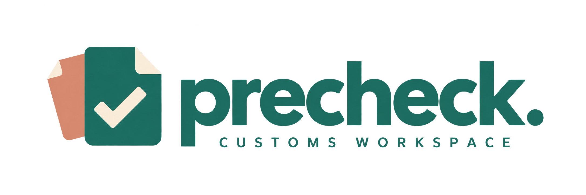
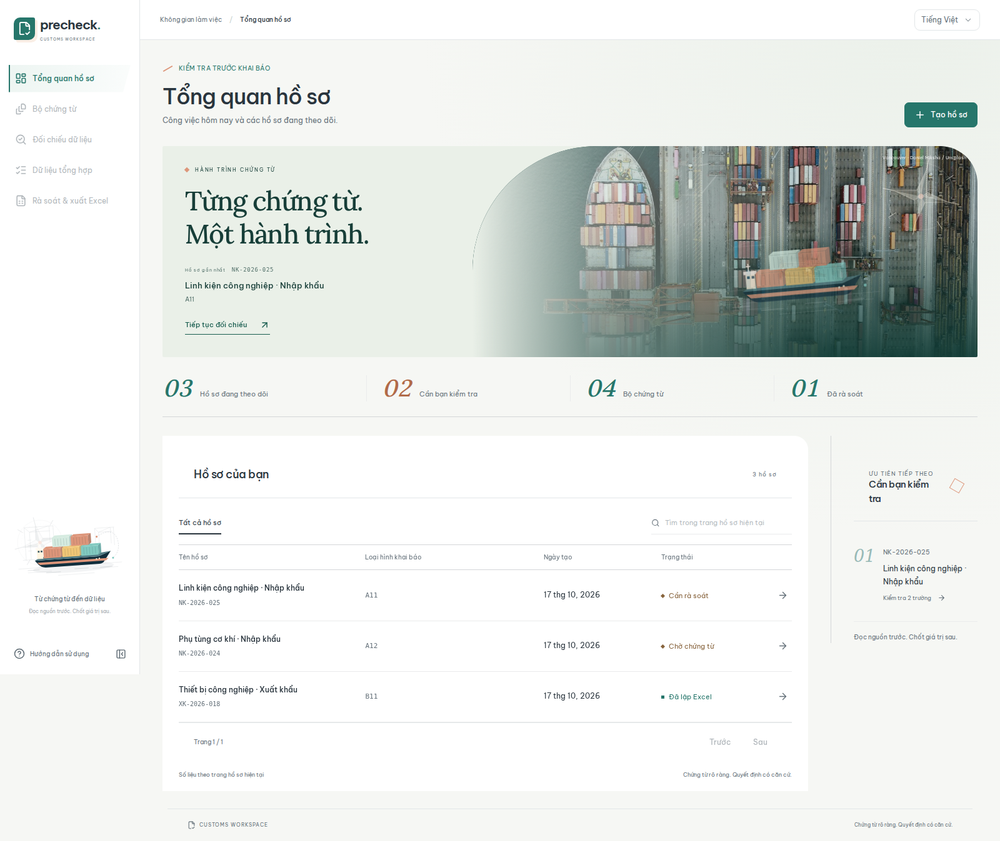
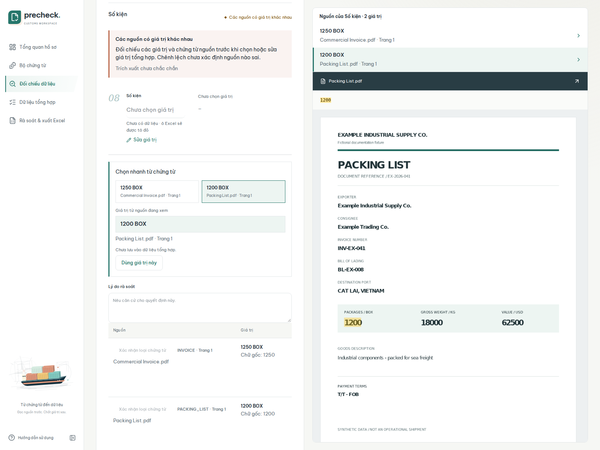
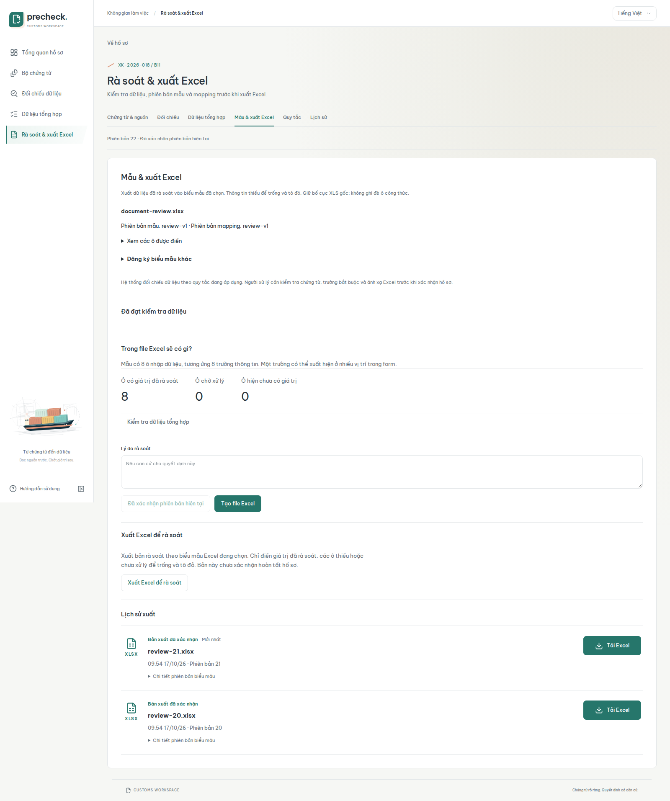
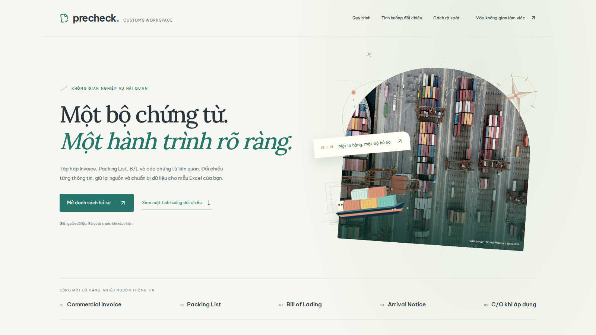

<p align="center">
  
</p>

# Customs pre-declaration workspace

An internal workspace for checking supporting documents before preparing a customs
Excel form. The workflow is **create a case → upload documents → extract sourced
proposals → reconcile differences → confirm consolidated values → export Excel**.
The product uses the Harbor interface and supports Vietnamese and English.

For the browser workflow, see the [Vietnamese user guide](docs/user-guide.vi.md).


Brand artwork generated with imagegen:
[transparent logo](docs/brand/precheck-logo.png) · [repository cover](docs/brand/precheck-cover.png).

## Interface

Captured from the running application with fictional cases and generated supporting
documents. These screenshots contain no operational shipment data; they illustrate
the interface rather than AI extraction accuracy.



| Source reconciliation                                                                                                       | Excel export history                                                                                                        |
| --------------------------------------------------------------------------------------------------------------------------- | --------------------------------------------------------------------------------------------------------------------------- |
| Compare document values beside the highlighted PDF and select an existing source value.                                     | Download an immutable workbook from its own export record.                                                                  |
| [](docs/screenshots/reconciliation.png) | [](docs/screenshots/excel-export.png) |

<details>
<summary>Product landing page</summary>



</details>

## Stack and scope

- React, TypeScript, Vite, TanStack Query and a generated OpenAPI client.
- FastAPI, Pydantic, SQLAlchemy, Alembic and PostgreSQL.
- Configurable OpenAI-compatible AI transport and versioned prompts.
- Local Tesseract OCR with word positions for scanned PDF evidence.
- A bounded in-process job runner; run a single API process/replica.
- Versioned XLSX and native XLS layouts, immutable export history and source provenance.
- Pytest, Vitest, Playwright and isolated Compose browser tests with a local AI stub.

AI proposes values; operators review and confirm them. A source value can be chosen
without retyping it, and both reconciliation panels stay synchronized with the PDF.
Manual consolidated values remain available. Missing or unresolved values remain blank
and red in review drafts. Completion approval is a separate action.

Cases can be archived and restored without changing their documents, decisions or exports.
Permanent application-record deletion requires the exact case reference; pending or
running jobs block both archiving and deletion. Shared private blob storage is retained
as described in the [runtime architecture](docs/runtime-architecture.md#case-lifecycle).

In **Reconciliation**, **Compare all differences · 1 AI call** sends all differing mapped
fields, source quotations and nearby context in one text-only request. Equivalent wording
is grouped for joint confirmation; substantive or uncertain differences remain available
for individual source selection or a manual value. AI can propose an exact existing value
or standardized text C. Original evidence and existing operator choices remain unchanged.
Confirming proposals does not approve the case or override arithmetic validation.

Unchanged evidence and comparison rules reuse the saved request, including after page reload, language changes
and value confirmation. There are no automatic paid retries. Oversized batches fail before
calling the provider rather than silently splitting into more calls. Input/output and
guard rejections use the existing private AI trace viewer. `AI_RECONCILIATION_MODEL` is
optional and otherwise reuses `AI_EXTRACTION_MODEL`; limits and the versioned prompt are
configured through settings. Ordinary extraction remains a separate workflow with its own
document/field batching.

Semantic comparison uses curated, source-linked administrative transitions and scoped
port/terminal relationships from `RECONCILIATION_REFERENCE_PATH`. The reference file is
extendable data, not an exhaustive legal or geographical dataset. Relevant references are
sent in the same request and retained with the proposal. An address may use its current
administrative form while retaining property identifiers. Port-level fields may consolidate
a supported terminal to its parent port; terminal-specific fields retain their precision.
Both standardized text C and source A/B still require operator confirmation. Updating the
prompt version or reference data makes the older request obsolete; a new request runs only
when the operator explicitly starts it.

The system does not transmit official customs declarations or certify legal/HS
correctness. Individual accounts and role-based authorization are not implemented.
Default network bindings are loopback; do not expose the unauthenticated API publicly.

## Local setup

Requirements: Node.js matching `.nvmrc`, Python 3.12, uv, Docker Compose, and Tesseract
with English/Vietnamese language data when running OCR outside the container.

```bash
cp .env.example .env
make setup
make up
```

The default app URL is `http://localhost:8080`. Configure `WEB_CONTAINER_PORT` in `.env`
for another port. Configure the AI endpoint, credentials and model through `.env`;
provider secrets never belong in frontend variables. Startup and ordinary tests do
not make paid AI requests.

The application imports example procedure references explicitly during startup.
These are implementation examples, not an authoritative legal dataset.
New-case forms initially select the enabled profile identified by
`DEFAULT_DECLARATION_PROFILE` (B11 by default). Operators can select another profile;
existing cases are unchanged. If the configured profile is unavailable, selection
remains required rather than falling back to an unrelated procedure.

To start the database and development servers separately:

```bash
make db
make migrate
make seed
make api
# In another terminal:
make web
```

Stop the Compose application without deleting operational data:

```bash
make down
```

To stop only backend and frontend containers while leaving the database running:

```bash
docker compose --env-file .env -f infra/compose.yaml --profile app stop api web
```

For foreground `make api` / `make web` processes, use `Ctrl+C` in their terminals.

## Excel templates and documents

Original shipment documents and operational Excel forms are private and excluded from
Git. Provide an authorized local form before using its layout in a new installation.
The import tool removes shipment values and registers a sanitized template profile;
it does not turn existing shipment data into defaults.

```bash
uv run --project services/api python scripts/import_excel_form.py \
  /path/to/approved-form.xls \
  reference-data/excel-layouts/original-form-xls-v9.json
```

The checked-in mappings describe field locations and supported groups; they do not
include the original workbook. `docs/templates/` contains a generic blank review
example and mapping. Tests generate their own synthetic PDFs and spreadsheets, so
original customer files are not required to build or test the repository.

On a case, review source pages and quotes, select or correct consolidated values,
then rerun validation. Choosing a source for preview does not save a decision.
**Use this value** opens explicit review confirmation and saves the exact source
identifier. **Edit value** allows a different consolidated value. Export history
provides a separate download action for each immutable workbook.

## Database browser

```bash
npm run db:studio
```

Prisma Studio opens on `http://127.0.0.1:5556` without automatically launching a browser.
It reads the configured PostgreSQL connection; SQLAlchemy and Alembic still own the
application schema. Stop Studio with `Ctrl+C`. If port 5556 is occupied, stop the
existing Studio process or choose a different port:

```bash
npx prisma studio --config ./prisma.studio.config.ts --browser none --port 5557
```

## Verification

```bash
make check
make test
npm run build
```

After API schema changes, run `npm run api:generate` and commit both the OpenAPI snapshot
and generated TypeScript contract. Keep dependency lockfiles committed.

For browser tests, install Chromium and use a disposable Compose project with the
synthetic AI transport. The `finally` cleanup below also runs when tests fail:

The test-only migration override generates synthetic blank workbooks from the public
mapping definitions. It requires the test environment and AI stub; operational startup
does not install these synthetic templates.

```bash
npx playwright install chromium
python3 - <<'PY'
import os
import subprocess

compose = [
    'docker', 'compose', '--env-file', '.env', '-p', 'ecus-browser-check',
    '-f', 'infra/compose.yaml', '-f', 'infra/compose.e2e.yaml', '--profile', 'app',
]
env = {
    **os.environ,
    'DATABASE_PORT': '55437',
    'WEB_CONTAINER_PORT': '8102',
    'E2E_BASE_URL': 'http://127.0.0.1:8102',
}
try:
    subprocess.run([*compose, 'up', '-d', '--build', '--wait'], env=env, check=True)
    subprocess.run(['npm', 'run', 'test:e2e'], env=env, check=True)
finally:
    subprocess.run([*compose, 'down', '-v', '--remove-orphans'], env=env, check=True)
PY
```

Use `down -v` only for disposable test projects. Preserve the main application volumes.

## Repository contents and privacy

- `apps/web/`: product frontend and localization resources.
- `services/api/`: API, domain services, provider adapters, migrations and synthetic tests.
- `packages/api-client/`: generated contract and typed client boundary.
- `reference-data/`: generic procedure/policy definitions and Excel layout metadata.
- `infra/`: Compose environments, reverse proxy and optional review gateway.
- `scripts/`: reference imports, form imports, contract generation and Git safety checks.
- `tests/`: browser scenarios and the synthetic AI server.
- `prototypes/ui-ux/`: three standalone design alternatives with fictional shipment fixtures.
- `docs/`: operator guides, reviewed engineering documentation, generic blank templates, brand artwork and fictional-data screenshots.

Original documents, private conversations, local design fixtures, operational output,
AI traces and historical acceptance reports remain local. They are not deleted.
Enable the repository's pre-commit privacy check in a new clone:

```bash
git config core.hooksPath .githooks
python3 scripts/check_git_safety.py
python3 scripts/check_git_safety.py --history
```

See [privacy rules](docs/repository-privacy.md), [runtime architecture](docs/runtime-architecture.md)
and [development conventions](docs/development.md). The original private planning and
review notes are intentionally not part of a public clone.

## Reuse the engineering approach

These guides explain the decisions behind the implementation and how to adapt them
to another project without copying operational data or assuming every dependency is needed:

- [Engineering playbook](docs/engineering-playbook.md): business boundaries, evidence,
  contracts, code organization, AI diagnosis, review UX, testing and tradeoffs.
- [Project bootstrap plan](docs/project-bootstrap-plan.md): phases with concrete exit
  evidence, from independent output references to reproducible deployment.
- [Reusable instructions and decision templates](docs/project-instructions-template.md):
  an adaptable `AGENTS.md`, architecture decision record and feature worksheet.

The runtime architecture describes supported behavior. The reusable guides identify
future improvements separately; they do not claim the system implements them already.
