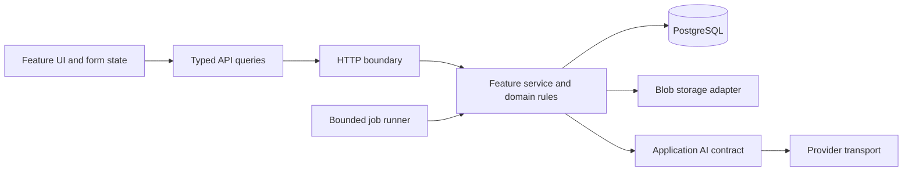
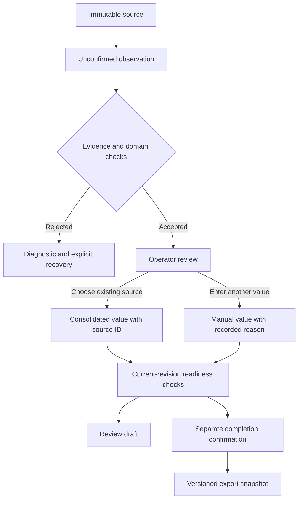

# Engineering playbook

This guide captures reusable engineering choices from this repository. It describes
why they help, where the current implementation demonstrates them, and when to choose
something else. It is not a claim that every module is an ideal implementation or that
the application is ready for every deployment.

Use the [bootstrap plan](project-bootstrap-plan.md) to start another project and the
[instruction template](project-instructions-template.md) to record its conventions.
For supported behavior here, the [runtime architecture](runtime-architecture.md) takes
precedence over historical local planning notes.

## 1. Start with the operator's decision

Write down the real sequence of work, the decisions that change its state, and the
artifact someone needs at the end. Identify which rules are known, configurable,
unresolved, or outside scope before choosing infrastructure.

In this application the sequence is documents → extraction → reconciliation →
consolidation → Excel export. A successful API call is only one step in that sequence.
It does not establish that the resulting workbook is usable.

For a new workflow, define these separately:

| Concept   | Question to answer                                              |
| --------- | --------------------------------------------------------------- |
| Input     | What is supplied, by whom, and in which supported formats?      |
| Evidence  | What proves a proposed value came from the stated source?       |
| Decision  | Who chooses or changes a value, and what reason is recorded?    |
| Rules     | What blocks progress, and what is merely informative?           |
| Output    | Which exact fields, file structure and formatting must survive? |
| Authority | What does confirmation mean, and what does it not establish?    |

Keep implementation discussion and delivery history out of product labels. The person
using the application should see their task, evidence and available actions.

## 2. Use a modular monolith until a boundary needs separate deployment

The useful unit is a business feature with explicit contracts, not a service for every
technical noun. Keep one deployable API while the team and workload fit that shape.

The diagram describes responsibilities and runtime calls. It does not require a generic
repository layer or dependency injection framework around every function.

| Layer                            | Owns                                                             | Keep out                                                 |
| -------------------------------- | ---------------------------------------------------------------- | -------------------------------------------------------- |
| HTTP boundary                    | Parsing, status codes, dependencies, service orchestration       | Normalization and business rules duplicated per endpoint |
| Feature service/domain functions | Invariants, state transitions, transaction decisions             | Provider-specific message types and browser concerns     |
| Adapter                          | Database, file and provider mechanics behind a concrete contract | Unrelated business policy                                |
| Frontend feature                 | Operator interaction, queries, unsaved form state                | Server authority for export or approval                  |
| Presentation                     | Tokens, layout, artwork and density                              | Copies of API state or alternative business rules        |

Representative code: [case service](../services/api/src/ecus_api/modules/cases/service.py),
[AI contract](../services/api/src/ecus_api/ai/contracts.py),
[API client boundary](../packages/api-client/src/index.ts).

Extract an abstraction when two concrete uses need the same behavior or one external
dependency needs isolation. A small provider protocol has a clear job. A universal CRUD
repository often hides useful SQL and transaction details without solving a real problem.

## 3. Make contracts, configuration and reference data separate

Use three distinct mechanisms:

- **Contract:** typed request/response schemas and stable error codes. Generate the web
  contract from the API schema; never maintain parallel handwritten interfaces.
- **Deployment configuration:** endpoints, credentials, ports, provider selection,
  limits and operational defaults. Validate them through settings.
- **Reference or policy data:** allowed business choices and versioned interpretation
  rules, imported explicitly and served through the API.

A default selection belongs in settings and must still resolve to an enabled reference
record. An unavailable default should not silently select a different business procedure.
Do not turn examples into an authoritative legal dataset.

The frontend renders API failures by stable code, with localized fallback text and an
optional request ID. It does not display arbitrary exception text or submitted documents.
All `VITE_` configuration is public browser configuration; it cannot hold a secret.

### Code style that makes boundaries visible

Use the existing language tools rather than maintaining formatting rules by hand:
Ruff formatting/linting and strict mypy for Python; ESLint, Prettier and TypeScript
checks for the web. Keep locks and generated-contract checks in the same quality gate.

- Python modules/functions use `snake_case`, domain types use `PascalCase`, and public
  service/adapter boundaries carry concrete type annotations. Use enums or literal
  unions for finite states rather than arbitrary strings passed throughout the system.
- Frontend files use the established descriptive `kebab-case` convention, React components
  use `PascalCase`, and functions/variables use `camelCase`. Name operations after their
  effect, such as `useDeleteCase`, rather than a generic `handleAction` shared by unrelated work.
- Separate boundary schemas from persistence models and feature state. Parse external
  input once at its boundary; avoid broad casts that turn unknown data into trusted types.
- Keep query keys and mutations beside the feature. Invalidate the affected server state
  after a successful mutation without discarding unrelated unsaved operator input.
- Comments explain constraints and non-obvious decisions, such as retaining shared blobs
  after record deletion. Do not narrate obvious syntax or leave abandoned plans in comments.
- Handle expected failures with stable codes. Catch unexpected exceptions only where a
  boundary can record a safe failure or perform cleanup; do not report success after swallowing one.
- Prefer a focused function or component with one responsibility. Split when business
  rules, transaction orchestration and presentation become hard to review independently;
  a line-count target is not an architectural boundary.

## 4. Keep evidence, proposals, choices and artifacts distinct

Preserve source bytes. Store extracted observations with source identity, page, quote,
normalization and provenance. Keep model confidence as metadata, not confirmation.

This is a responsibility map, not a promise that all transitions have the same gate.
Review drafts deliberately allow unresolved values while completed output has stricter
requirements. Downloading an older artifact must not recompute it from today's state.

Corrections append or supersede observations and preserve the original. Copying an
existing source value records its observation ID; manual entry remains distinguishable.
A file preview is not a saved choice. Application confirmation is not legal certification
or an authenticated independent approval when those controls do not exist.

The same pattern fits invoice review, document verification and other evidence-based
workflows. It may be excessive for a disposable calculator with no review history.

## 5. Protect decisions against stale state

Every meaningful mutation should state which revision it edits. Validate that revision
and use a database concurrency mechanism to prevent a check-then-write race. Return a
stable conflict code instead of overwriting another operator's work.

Input, rule or template changes invalidate dependent confirmation. Background results
must also check the input revision before applying proposals. A frontend disabled button
cannot enforce these invariants.

Keep transaction ownership explicit. Use a fresh SQLAlchemy session per request or job
transaction; never share an `AsyncSession` between concurrent tasks. Migration changes
go through Alembic. `metadata.create_all` belongs only in isolated tests.

The review aggregate currently uses versioned JSON state. That simplifies snapshots but
can make large histories, relational queries and fine-grained concurrent edits expensive.
Split measured hotspots into relational structures when those costs become material;
do not rename a large mutable aggregate “event sourcing.”

## 6. Treat AI integration as a pipeline you can inspect

The application depends on its own structured AI contract. The transport adapts provider
requests and responses. Versioned prompts, input selection and evidence validation are
separate concerns; each can fail independently.

An OpenAI-compatible endpoint is a transport option. It does not guarantee identical
vision support, schema behavior, context limits or extraction quality on another host.
Self-hosting requires capability checks and representative evaluations before switching.

For each run, distinguish the following outcomes:

| Stage             | Evidence to inspect                                                  | Example failure                                       |
| ----------------- | -------------------------------------------------------------------- | ----------------------------------------------------- |
| Input preparation | Selected files, pages, requested fields, text and image availability | Relevant page or field never supplied                 |
| Provider request  | Model configuration, prompt version, transport status, request ID    | Unsupported capability or timeout                     |
| Proposal          | Parsed field values and nullable results                             | Field omitted, wrong role or unsupported inference    |
| Evidence guard    | Accepted/rejected result with stable reason                          | Correct-looking value cannot be anchored exactly      |
| Domain checks     | Types, units, applicability, arithmetic, source relationships        | Non-equivalent values treated as interchangeable      |
| Review            | Existing-source choice versus manual correction                      | A preview mistaken for a saved decision               |
| Export            | Snapshot values and actual workbook cells                            | Correct consolidated value mapped to the wrong target |

Table layouts are a concrete caution: a model can read a number correctly from the page
image while returning a context assembled in visual order. The PDF text extractor may
store another order. Strict quote matching can then reject a correct number. Repeated
values make “take the first match” unsafe. Diagnose the evidence layer rather than
assuming a stronger model will solve the problem.

Private traces may retain enough input/output for local diagnosis, subject to explicit
access, retention and storage controls. Routine logs should contain IDs, durations,
status and rejection codes, not entire documents, image payloads or credentials. Do not
commit real traces as regression fixtures; derive a minimal synthetic example instead.

## 7. Give slow work bounded execution and honest recovery

Heavy OCR or provider latency justifies background processing even when the application
is business-focused. It does not automatically justify Redis, Celery or distributed workers.

The current runner persists job status but executes tasks in one API process. It bounds
concurrency, pending work and timeouts; progress is visible; interrupted work requires an
explicit retry. It is **not a durable distributed queue**. Deduplicating active jobs is
also not the same as exactly-once provider execution.

| Observed need                                     | Suitable next decision                                       |
| ------------------------------------------------- | ------------------------------------------------------------ |
| One API instance and a small bounded workload     | Keep the current runner and measure wait time                |
| Reliable recovery through API restarts            | Design durable work claiming and retry semantics             |
| Multiple API replicas or independently scaled OCR | Separate worker lifecycle and coordinate ownership           |
| Provider call could have succeeded before a crash | Define idempotency, partial progress and cost-aware recovery |

Before adding a queue, define timeout, cancellation, ordering, stale-result rejection,
deduplication, retry ownership and shutdown behavior. Infrastructure cannot infer these
business decisions.

## 8. Design the interface around reviewing and acting

Put the item being reviewed, its competing values, the selected candidate and the source
preview within one coherent interaction. Synchronize source selection and PDF navigation.
Keep a separate save action with clear pending, saved, stale and failed states.

For document-heavy screens:

- Bound the source list and PDF scroll containers independently, with visible selected
  states and usable keyboard focus.
- Provide both a quick existing-value choice and manual entry, preserving the difference
  in provenance.
- Use explicit download actions per export record rather than an ambiguous inline link.
- Test loading, empty, conflict, error, overflow and narrow layouts using generated data.
- Wait for the PDF render-ready state before claiming a screenshot shows evidence.

Store product text in aligned locales, use `Intl` formatting and label controls through
translation keys. Keep one feature state and query layer under presentation changes.
The app currently ships Harbor only; the three-design studio is an isolated prototype,
not three alternate runtime implementations to copy into feature logic.

## 9. Prove behavior at the right level

Use small deterministic tests for normalization, evidence guards, revision conflicts and
business gates. Use API/database tests for transactions and persisted history. Use
Playwright against isolated PostgreSQL and a local AI stub for operator flows and actual
file downloads. Open the generated workbook and assert cells, types, formulas and layout
properties relevant to the change.

Mocked transport proves application behavior for a known response. It does not prove the
live model reads a real document correctly. A deliberate live evaluation needs an
independent expected result and must record:

- Which authorized input set, configuration and prompt produced the result.
- Which proposals survived evidence and domain checks.
- Which values were copied from sources and which were manually entered.
- Which exact artifact was checked and which fields remain unreviewed.
- How the isolated environment was stopped, including failure paths.

Do not call a manually corrected export an untouched AI success. “Job succeeded,”
“proposal accepted,” “operator confirmed,” and “export matched the reference” are
different assertions. State which one was actually observed.

## 10. Build privacy and reproducibility into the repository

Commit code, locks, generated contracts, migrations, synthetic fixtures and reviewed
technical documentation. Keep source documents, local planning, credentials, exports,
traces and databases out of Git. A clone should build and run synthetic tests without
copying operational data.

Use an explicit documentation allowlist, staged/history scans, and human review for new
binaries and screenshots. Pattern scanners cannot prove arbitrary text is anonymous.
Ignoring a published file does not erase its Git history.

Keep deployment values configurable and default to loopback. For internal applications
without individual accounts, any remote route needs an appropriate access boundary.
Installing a tunnel does not add application authorization. Restore or deletion behavior
must also distinguish removing records from securely erasing retained shared blobs.

## Improvements to carry into the next project

These are design recommendations, not features claimed to be complete here:

| Priority      | Improvement                                                                   | Evidence that would justify completion                                          |
| ------------- | ----------------------------------------------------------------------------- | ------------------------------------------------------------------------------- |
| First         | Define the output contract and independent synthetic reference before AI work | One pass and one failure flow reach checked artifacts                           |
| First         | Maintain a per-field evaluation ledger across the entire pipeline             | Input, proposal, rejection, decision and output outcomes remain distinguishable |
| First         | Handle PDF table reading order and repeated evidence deliberately             | Correct source region is proven; ambiguous alternatives still fail safely       |
| Next          | Turn reference policies and layouts into governed, versioned inputs           | Updating a rule invalidates dependent review and preserves old exports          |
| Next          | Establish backup/restore and private-trace retention procedures               | A restore is exercised without exposing or overwriting operational data         |
| When required | Add authenticated actors and roles                                            | Actual deployment needs and authorization tests define the scope                |
| When measured | Extract durable workers or split aggregate persistence                        | Restart, queue depth, query cost or contention measurements justify the change  |

Carry the decision rules forward, not every dependency or module name. A smaller project
may need fewer layers; a broader deployment may need stronger identity, recovery and
data-management controls from the start.
